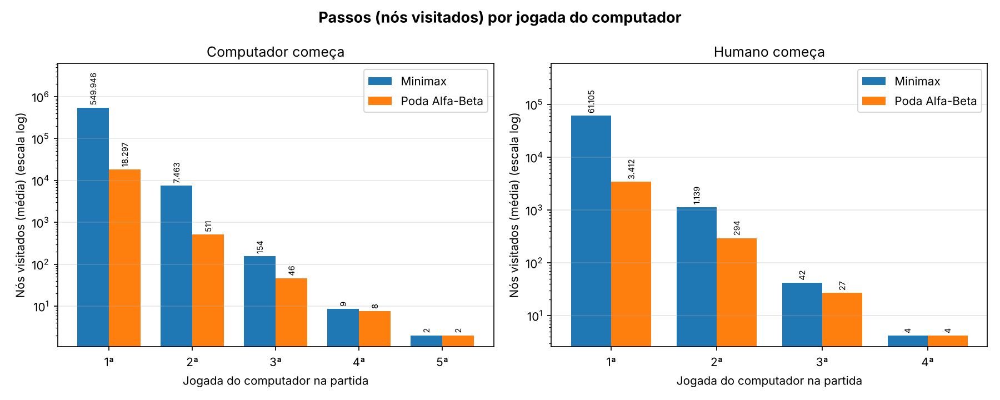
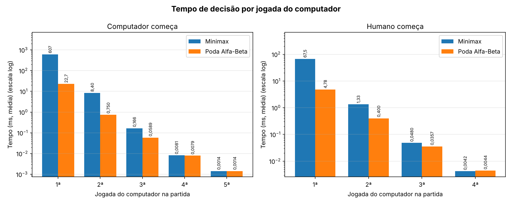
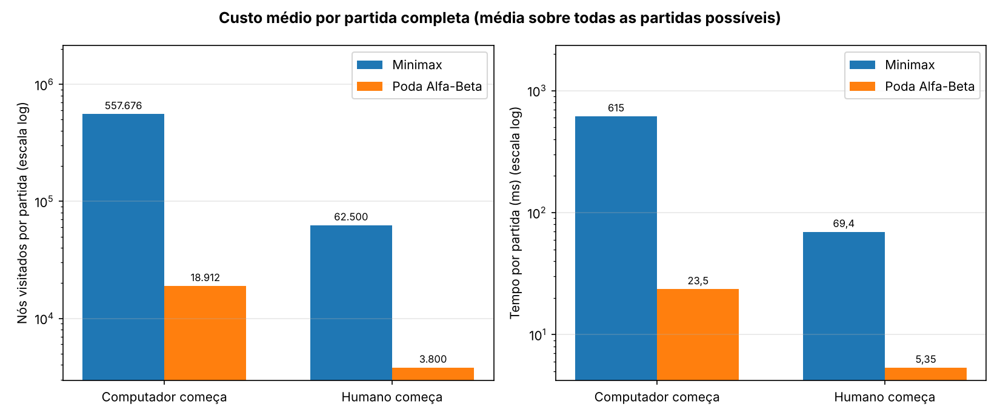
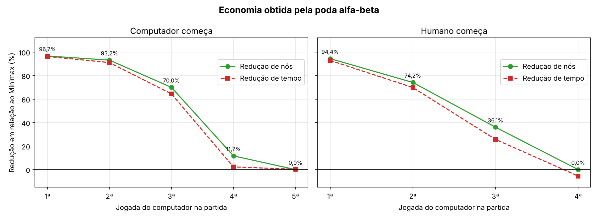
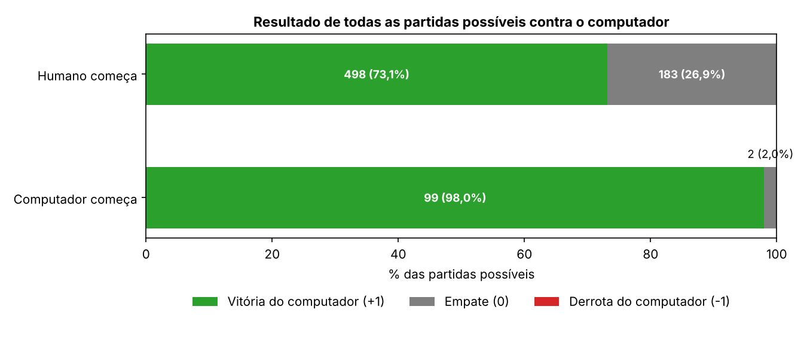

# Jogo da Velha com Minimax e Poda Alfa-Beta

Software jogador de Jogo da Velha que usa **busca adversarial** (Minimax e Poda Alfa-Beta) para decidir suas jogadas, com análise comparativa de **passos** (nós visitados) e **tempo de execução** entre os dois algoritmos.


---

## Identificação do trabalho

| | |
|---|---|
| **Instituição** | Instituto Federal do Piauí (IFPI) |
| **Campus** | Picos |
| **Curso** | Tecnólogo em Análise e Desenvolvimento de Sistemas |
| **Módulo / Período** | Módulo III  |
| **Disciplina** | Inteligência Artificial |
| **Professor** | Rogério Figueredo de Sousa |
| **Aluno** | José Neres |
| **Data da proposta** | 16/11/2026 |
| **Data de entrega** | 01/12/2026 |

---

## Sumário

1. [Sobre o trabalho](#-sobre-o-trabalho)
2. [Funcionalidades](#-funcionalidades)
3. [Estrutura do repositório](#-estrutura-do-repositório)
4. [Requisitos](#-requisitos)
5. [Como usar](#-como-usar)
6. [Como o programa funciona](#-como-o-programa-funciona)
7. [Resultados dos experimentos](#-resultados-dos-experimentos)
8. [Testes automáticos](#-testes-automáticos)
9. [Relatório](#-relatório)
10. [Decisões de implementação](#-decisões-de-implementação)
11. [Referências](#-referências)

---

## Sobre o trabalho

O enunciado pede a construção de um software que jogue Jogo da Velha utilizando:

- **Minimax**, com avaliação dos nós terminais igual a **+1** (vitória), **−1** (derrota) e **0** (empate);
- **Poda Alfa-Beta**.

O programa deve ter dois modos de funcionamento (**Humano x Computador** e **Computador x Computador**) e receber como entrada **quem inicia o jogo**. Além do software, deve ser entregue um relatório com a formulação do problema, a apresentação do software, a análise da execução de cada algoritmo (passos e tempo, com gráficos) e a comparação do custo da solução encontrada por cada um.

---

## Funcionalidades

- Algoritmo **Minimax** completo.
- Algoritmo **Poda Alfa-Beta**.
- Modo **Humano x Computador**, com escolha do algoritmo do computador.
- Modo **Computador x Computador**, com escolha do algoritmo de cada lado (é possível confrontar Minimax × Alfa-Beta).
- Escolha de **quem começa** a partida.
- Contagem de **passos** (nós visitados) e **tempo** de cada decisão, exibidos durante o jogo e em uma tabela-resumo ao final.
- Validação de entradas (casa ocupada, valor inválido etc.).
- Testes automáticos e script de experimentos que gera gráficos e tabelas.

---

## Estrutura do repositório

```
.
├── README.md                       # este arquivo
├── LEIA-ME.txt                     # resumo de uso em texto simples
├── Relatorio_Jogo_da_Velha.docx    # relatório do trabalho
├── codigo/
│   ├── jogo.py                     # programa principal (menu e modos de jogo)
│   ├── algoritmos.py               # regras do jogo, Minimax e Poda Alfa-Beta
│   ├── experimentos.py             # coleta de dados e geração de gráficos
│   ├── testes.py                   # testes automáticos
│   └── requirements.txt            # dependência opcional (matplotlib)
└── resultados/
    ├── grafico1_nos_por_jogada.png
    ├── grafico2_tempo_por_jogada.png
    ├── grafico3_totais_por_partida.png
    ├── grafico4_reducao_percentual.png
    ├── grafico5_resultados_das_partidas.png
    ├── decisoes_detalhadas.csv     # todas as decisões medidas
    ├── resumo_por_jogada.csv
    ├── resumo_por_partida.csv
    └── resumo.json
```

---

## Requisitos

| Para... | Você precisa de... |
|---|---|
| **Jogar** e rodar os **testes** | Apenas o **Python 3.8+** (nenhuma biblioteca externa) |
| Rodar os **experimentos** (gerar gráficos) | Python 3.8+ e a biblioteca **matplotlib** |

Testado com Python 3.12.

---

## Como usar

### 1. Baixar o projeto

```bash
git clone https://github.com/<seu-usuario>/<nome-do-repositorio>.git
cd <nome-do-repositorio>/codigo
```

> Se baixou o `.zip`, basta extrair e abrir o terminal dentro da pasta `codigo`.

### 2. Jogar

```bash
python jogo.py
```

> No Linux/macOS, se necessário, use `python3 jogo.py`.

Você verá o menu principal:

```
Menu principal
  1) Humano x Computador
  2) Computador x Computador
  0) Sair
```

####  Modo 1: Humano x Computador

1. Escolha o **algoritmo do computador** (Minimax ou Poda Alfa-Beta).
2. Escolha **quem começa** (humano ou computador). Quem começa joga com **X**.
3. Para jogar, digite o **número da casa (1 a 9)** mostrado no tabuleiro:

```
   1 | 2 | 3
  ---+---+---
   4 | 5 | 6
  ---+---+---
   7 | 8 | 9
```

A cada jogada do computador, o programa mostra a casa escolhida, os **nós visitados** e o **tempo** gasto.

####  Modo 2: Computador x Computador

1. Escolha o **algoritmo do Computador 1** e do **Computador 2**.
2. Escolha **qual deles começa** (o que começa joga com **X**).
3. A partida é executada automaticamente. Ao final, uma tabela compara os passos e o tempo de cada algoritmo.

### 3. Exemplo de sessão

```
Computador (O) jogou na casa 5  [2.338 nós visitados, 2,970 ms]

   X | 2 | 3
  ---+---+---
   4 | O | 6
  ---+---+---
   7 | 8 | 9

[...]

>>> Computador (O) venceu a partida!

==================================================================
  ESTATÍSTICAS DAS JOGADAS DO COMPUTADOR
==================================================================
   Nº Algoritmo        Casa  Valor  Nós visitados  Tempo (ms)
  --------------------------------------------------------------
    1 Poda Alfa-Beta      5      0          2.338       2,970
    2 Poda Alfa-Beta      2      0            112       0,142
    3 Poda Alfa-Beta      4     +1             15       0,025
    4 Poda Alfa-Beta      6     +1              4       0,005
  --------------------------------------------------------------
  TOTAL Poda Alfa-Beta  nós:      2.469   tempo: 3,142 ms
==================================================================
```

> Os números no formato brasileiro: ponto separa milhares e vírgula separa decimais (`2.338` = dois mil trezentos e trinta e oito; `2,970 ms` = dois vírgula noventa e sete milissegundos).

---

##  Como o programa funciona

### Formulação do problema

| Componente | Definição |
|---|---|
| **Estado** | Tabuleiro 3×3 (cada casa com `X`, `O` ou vazia) e o jogador da vez |
| **Estado inicial** | Tabuleiro vazio; quem inicia joga com `X` |
| **Jogadores** | O computador é **MAX**; o oponente é **MIN** |
| **Ações** | Casas vazias do tabuleiro |
| **Resultado** | Tabuleiro com o símbolo do jogador da vez na casa escolhida |
| **Teste de término** | Três símbolos iguais em linha, coluna ou diagonal, ou tabuleiro cheio |
| **Utilidade** | **+1** vitória do computador, **−1** derrota, **0** empate |

Números do espaço de busca (conferidos pelo código): **549.946** nós na árvore de jogo completa, **255.168** partidas possíveis e **5.478** configurações de tabuleiro distintas.

### Minimax

Explora **toda** a árvore de jogo assumindo que os dois jogadores jogam otimamente: MAX escolhe o maior valor entre os filhos e MIN escolhe o menor. Complexidade de tempo `O(b^m)`.

### Poda Alfa-Beta

Calcula **exatamente o mesmo valor** do Minimax, mas descarta ramos que não podem alterar a decisão, mantendo dois limites: **α** (melhor valor garantido para MAX) e **β** (melhor valor garantido para MIN). Quando `α ≥ β`, os filhos restantes do nó são podados. No melhor caso, a complexidade cai para `O(b^(m/2))`.

---

## Resultados dos experimentos

Para uma comparação justa, o "humano" foi **simulado de forma exaustiva**: em cada vez dele, todas as casas livres são testadas. Assim são percorridas **todas as 782 partidas possíveis** contra o computador (**1.069 decisões** analisadas), e em cada decisão os **dois algoritmos rodam sobre o mesmo tabuleiro**. O tempo é o menor de 3 execuções.

### Resumo

| Medida | Minimax | Poda Alfa-Beta | Redução |
|---|--:|--:|--:|
| Nós na 1ª jogada (tabuleiro vazio) | 549.946 | 18.297 | **96,7%** |
| Tempo na 1ª jogada (tabuleiro vazio) | ≈ 607 ms | ≈ 22,7 ms | **96,3%** |
| Nós na 1ª jogada, humano começando (média) | 61.105 | 3.412 | **94,4%** |
| Nós por partida, computador começa (média) | 557.676 | 18.912 | **96,6%** |
| Nós por partida, humano começa (média) | 62.500 | 3.800 | **93,9%** |

> Os **tempos** dependem da máquina (os valores acima são de uma execução de referência). Os **passos** (nós visitados) são determinísticos e sempre iguais.

### Conclusões principais

- Os dois algoritmos escolheram **a mesma jogada em 100% das 1.069 decisões**: a poda não altera a qualidade da solução, apenas reduz o esforço.
- O computador **nunca perdeu** nenhuma das 782 partidas possíveis. Com jogo perfeito, o Jogo da Velha termina em **empate** (valor do jogo = 0).
- A economia da poda é **maior nas primeiras jogadas** (árvore grande) e **diminui no final** (poucas casas livres, pouco a podar).

### Gráficos

**Passos por jogada do computador**



**Tempo de decisão por jogada do computador**



**Custo médio por partida completa**



**Economia obtida pela poda**



**Resultado de todas as partidas possíveis**



### Refazer os experimentos

```bash
cd codigo
pip install matplotlib
python experimentos.py
```

Leva cerca de 1 minuto e regera os gráficos (`.png`) e as tabelas (`.csv` / `.json`) na pasta `resultados/`.

---

## Testes automáticos

```bash
cd codigo
python testes.py
```

Os testes verificam:

- as regras do jogo e a função de utilidade (+1 / −1 / 0);
- que o Minimax no tabuleiro vazio visita exatamente **549.946 nós**;
- que o computador **vence quando pode** e **bloqueia quando precisa**;
- de forma **exaustiva**, que o computador **nunca perde** (começando ou não) e que **Minimax e Alfa-Beta escolhem a mesma jogada** em todas as decisões possíveis.

---

## Relatório

O arquivo [`Relatorio_Jogo_da_Velha.pdf`](Relatorio_Jogo_da_Velha.pdf) contém:

1. Introdução
2. Formulação do problema
3. Apresentação do software
4. Metodologia dos experimentos
5. Análise da execução dos algoritmos (passos e tempo, com gráficos)
6. Análise comparativa do custo da solução
7. Conclusão e referências

---

## Decisões de implementação

- **Passos = nós visitados.** Cada chamada da função recursiva conta 1 nó, incluindo a raiz e os nós terminais.
- **Tempo** medido com `time.perf_counter`, somente na decisão do computador (não inclui a espera pelo humano nem a impressão na tela).
- **Mesma jogada nos dois algoritmos.** Ambos exploram as casas na ordem 1 a 9 e, em caso de empate de valor, escolhem a primeira melhor jogada. Isso permite comparar apenas o custo.
- **Sem heurística de ordenação.** As casas não são reordenadas; por isso, os ganhos da poda observados não representam o melhor caso teórico.
- **Utilidade sem profundidade.** Conforme o enunciado, os terminais valem apenas +1, −1 ou 0; o computador não distingue vitória rápida de vitória demorada.

---

## Referências

- RUSSELL, S. J.; NORVIG, P. **Artificial Intelligence: A Modern Approach**. 4. ed. Hoboken: Pearson, 2020.
- KNUTH, D. E.; MOORE, R. W. An analysis of alpha-beta pruning. **Artificial Intelligence**, v. 6, n. 4, p. 293-326, 1975.

---

## Autoria


Desenvolvido por **José Neres** como trabalho da disciplina de **Inteligência Artificial** — IFPI Campus Picos, 2026.


> ℹProjeto acadêmico, desenvolvido para fins de estudo.
